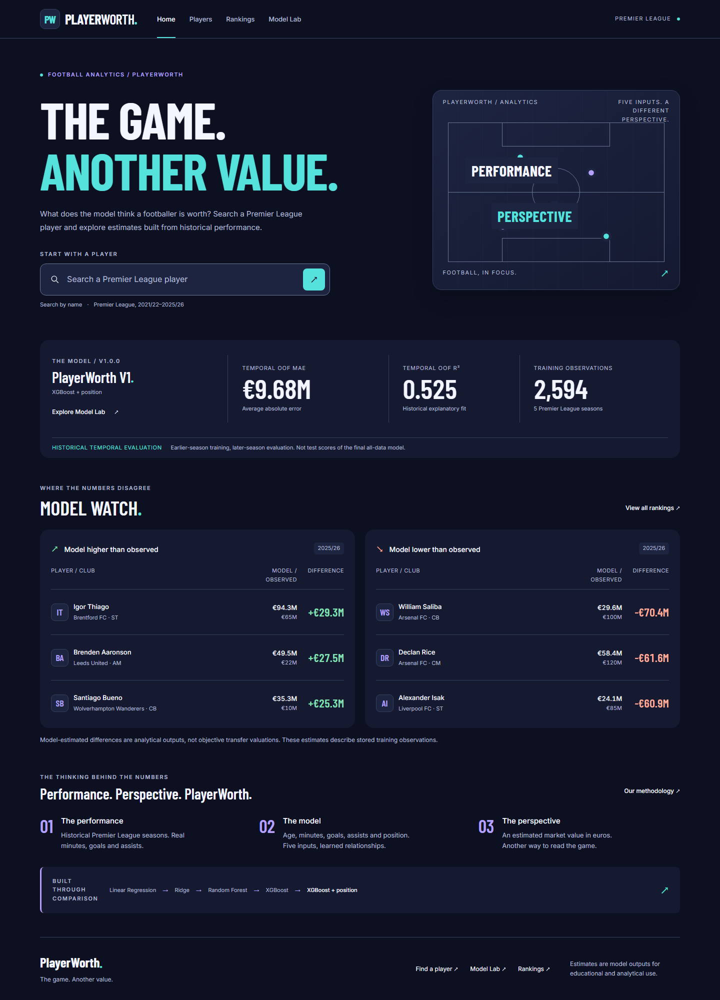
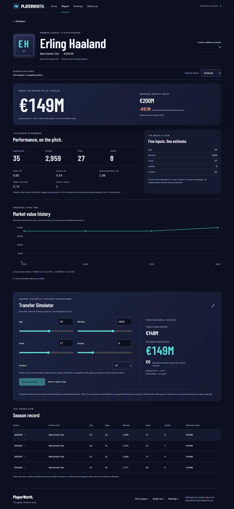
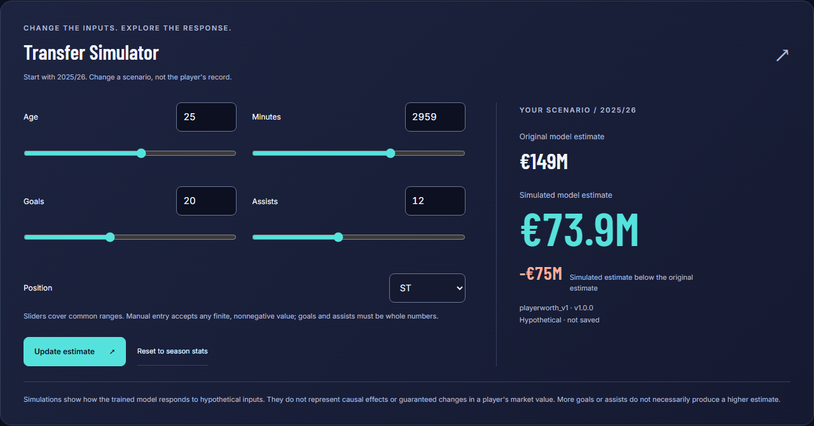
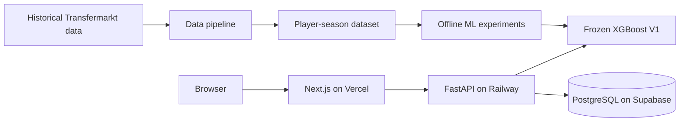

# PlayerWorth

**The game. Another value.**

PlayerWorth is a full-stack football analytics and machine-learning application that estimates Premier League player market values from historical performance data.

It combines a production Next.js frontend, FastAPI backend, PostgreSQL database, and a frozen XGBoost model into one deployed product where users can search players, inspect valuations, simulate hypothetical stat changes, and explore which players the model considers overvalued or undervalued.

## Live product

**Live app:** https://playerworth.vercel.app



## What PlayerWorth does

- **Player search** — find Premier League players and open season-aware profiles.
- **ML market-value estimates** — compare the model estimate with recorded market value.
- **Transfer Simulator** — change age, minutes, goals, assists, or position and see how the model responds without modifying stored data.
- **Valuation history** — inspect season-by-season values and model deltas.
- **Rankings** — explore players whose predicted value is above or below their recorded valuation.
- **Model Lab** — see the experiment history, feature importance, temporal evaluation, and limitations behind V1.

| Player profile | Transfer Simulator |
|---|---|
|  |  |

Additional views: [Model Lab](docs/screenshots/model-lab-desktop.png) · [Rankings](docs/screenshots/rankings-desktop.png) · [Mobile home](docs/screenshots/home-mobile.png) · [Mobile player](docs/screenshots/player-mobile.png)

## Why I built it

Football valuation is a useful ML problem because the target is noisy, non-linear, and influenced by far more than goals alone.

PlayerWorth was built to go beyond a notebook experiment and answer a harder engineering question:

> Can a football valuation model be turned into a complete, explainable, tested, deployed application?

That meant building the entire path from historical data processing and model comparison to inference, APIs, persistence, UI, testing, and production deployment.

## Machine-learning pipeline

The production model, **playerworth_v1 v1.0.0**, is an XGBoost pipeline using:

- age
- minutes
- goals
- assists
- position

The model was selected after comparing:

- Linear Regression
- Ridge Regression
- Random Forest
- XGBoost
- XGBoost + position
- per-90 feature experiments

Per-90 features were tested but rejected for V1 because they did not improve the temporal evaluation enough to justify the added complexity.

### Dataset

The processed dataset contains **2,594 Premier League player-seasons** spanning **2021/22 through 2025/26**.

To reduce target leakage, each season is matched to a market valuation dated on or after the final Premier League match and within a 45-day window.

### Temporal evaluation

Model selection used expanding-window temporal backtesting rather than a random train/test split.

| Historical pooled temporal metric | Result |
|---|---:|
| MAE | **€9.68M** |
| RMSE | **€15.05M** |
| R² | **0.525** |
| Out-of-fold predictions | **2,103** |

The final production artifact was then fit on all **2,594** available player-season rows.

These predictions are estimates, not transfer fees or objective true values. The model intentionally exposes its limitations rather than presenting predictions as certainty.

For more detail, see the [model card](docs/MODEL_CARD_V1.md), [ML input contract](docs/ML_INPUT_V1.md), and [temporal backtesting notes](docs/TEMPORAL_BACKTESTING.md).

## Architecture



### Production stack

**Frontend**
- Next.js 16
- React 19
- TypeScript
- Recharts
- responsive custom CSS design system
- Vercel

**Backend**
- FastAPI
- Pydantic
- SQLAlchemy 2
- Alembic
- psycopg
- Railway

**Machine learning**
- Python
- Pandas
- scikit-learn
- XGBoost
- joblib

**Database**
- PostgreSQL
- Supabase

**Testing and quality**
- pytest
- Ruff
- Vitest
- Testing Library
- Playwright
- axe accessibility checks

## Production deployment

PlayerWorth is deployed as a three-service production stack:

```text
Browser
   |
   v
Vercel / Next.js
   |
   v
Railway / FastAPI
   |
   +----> Supabase PostgreSQL
   |
   +----> frozen playerworth_v1 model
```

The browser never connects directly to the database. All application data and inference requests go through the FastAPI service.

The frontend uses:

```text
NEXT_PUBLIC_API_BASE_URL=https://<backend>/api/v1
```

The backend uses environment-based database configuration and an explicit CORS allowlist.

See [DEPLOYMENT.md](docs/DEPLOYMENT.md) for the full deployment procedure.

## API

The backend exposes versioned endpoints under:

```text
/api/v1
```

Core routes include:

- health
- player search
- player detail
- player predictions
- simulation
- current model metadata
- undervalued rankings
- overvalued rankings

See [API.md](docs/API.md) for details.

## Local development

### Requirements

- Python 3.14
- Node.js 24
- PostgreSQL

### Backend

From the project root:

```powershell
python -m venv .venv
.venv\Scripts\Activate.ps1
python -m pip install -r requirements-dev.txt
```

Create your local environment configuration using [.env.example](.env.example) as a reference.

Then run migrations and seed the database:

```powershell
python -m alembic upgrade head
python -m scripts.seed_database
python -m backend.app.main
```

### Frontend

In another terminal:

```powershell
cd frontend
npm ci
$env:NEXT_PUBLIC_API_BASE_URL="http://localhost:8000/api/v1"
npm run dev
```

Then open:

```text
http://localhost:3000
```

The local FastAPI documentation is available at:

```text
http://localhost:8000/docs
```

## Validation

The release was validated across backend, frontend, browser, and accessibility tests.

Key checks include:

- **218 Python tests**
- **60 Vitest tests**
- **37 Playwright end-to-end tests**
- production Next.js build
- lint and TypeScript checks
- database migration validation
- repeated idempotent database seeding
- responsive browser testing
- accessibility checks

Typical validation commands:

```powershell
python -m pytest -q
python -m ruff check backend ml scripts tests
python -m ruff format --check backend ml scripts tests
```

From `frontend/`:

```powershell
npm run lint
npm run typecheck
npm test
npm run build
npm run test:e2e
```

See [RELEASE_VALIDATION.md](docs/RELEASE_VALIDATION.md) for the detailed release checklist.

## Repository structure

```text
frontend/            Next.js application, components, API client, UI tests
backend/app/         FastAPI routes, services, schemas, database models
backend/migrations/  Alembic migrations
ml/                  Data pipeline, experiments, training and inference
scripts/             Data, database and release tooling
tests/               Release-level tests
docs/                Architecture, model, API, deployment and design docs
```

Raw datasets, generated processed datasets, local environments, secrets, deployment staging files, and generated model artifacts are intentionally excluded from Git.

## Limitations

PlayerWorth V1 is intentionally narrow:

- Premier League only
- five primary model inputs
- no contract-length information
- no injury history
- no club-strength feature
- no live feed
- no causal interpretation of simulator changes
- market-value targets remain subjective and highly skewed
- negative model outputs are possible and are not silently clipped

The goal of V1 is not to claim perfect football valuation. It is to build a reproducible, inspectable ML product and make the tradeoffs visible.

## Documentation

- [Model card](docs/MODEL_CARD_V1.md)
- [Model Lab](docs/MODEL_LAB.md)
- [Temporal backtesting](docs/TEMPORAL_BACKTESTING.md)
- [Transfermarkt data notes](docs/TRANSFERMARKT_DATA.md)
- [Database](docs/DATABASE.md)
- [API](docs/API.md)
- [Frontend](docs/FRONTEND_README.md)
- [Player profiles](docs/PLAYER_PROFILE.md)
- [Rankings](docs/RANKINGS_UI.md)
- [Brand and design](docs/BRAND_AND_DESIGN.md)
- [Deployment](docs/DEPLOYMENT.md)
- [Release validation](docs/RELEASE_VALIDATION.md)

---

Built as an end-to-end ML engineering project: **data → model → API → database → frontend → production deployment**.
