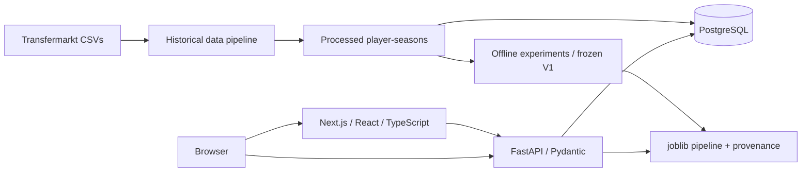

# PlayerWorth

**The game. Another value.**

A full-stack football analytics project that estimates Premier League player market
values from historical performance, explains the evidence behind the model, and
lets you explore hypothetical changes without saving them as real player data.

**V1 application complete / deployment configuration complete.** Validated locally
with a production frontend build, real PostgreSQL and the frozen model. Public
deployment awaits provider authentication; there is no live URL to claim yet.


## Explore the product

- Search real players and open season-aware profiles.
- Compare the model estimate with the recorded market valuation and view history.
- Change age, minutes, goals, assists or position in the unsaved Transfer Simulator.
- Explore rankings where model estimates are above or below observed values.
- Follow the experiment history, temporal evaluation and limitations in Model Lab.

| Player profile | Transfer Simulator |
|---|---|
|  |  |

More captures: [Model Lab](docs/screenshots/model-lab-desktop.png),
[rankings](docs/screenshots/rankings-desktop.png),
[mobile home](docs/screenshots/home-mobile.png),
[mobile player](docs/screenshots/player-mobile.png).

## Model and evidence

The frozen `playerworth_v1` model is an XGBoost pipeline using **age, minutes,
goals, assists and position**. It was selected after Linear Regression, Ridge,
Random Forest and XGBoost experiments, followed by temporal backtesting. Per-90
features were evaluated and rejected from V1.

The processed dataset contains **2,594 player-seasons** across 2021/22–2025/26.
Each target valuation is on or after the final Premier League game, within 45 days.
The final deployment artifact fits all five seasons. Its historical evidence is
**2,103 earlier out-of-fold predictions**, not a test score of that all-data fit:

| Historical pooled temporal metric | Result |
|---|---:|
| MAE | €9,677,493.908572 |
| RMSE | €15,046,414.971176 |
| R² | 0.525160448535 |

These estimates are neither transfer fees nor objective “true values”. Rankings
describe differences on stored training observations. Simulator changes describe
model behavior, not causal effects. See the [model card](docs/MODEL_CARD_V1.md),
[inference contract](docs/ML_INPUT_V1.md) and [Model Lab guide](docs/MODEL_LAB.md).

## Architecture and stack



Frontend: Next.js 16, React 19, TypeScript, semantic CSS tokens, Recharts.
Backend: FastAPI, SQLAlchemy 2, psycopg, Alembic, PostgreSQL.
ML: Pandas, scikit-learn, XGBoost, joblib.
QA: pytest, Ruff, Vitest/Testing Library, Playwright and axe.

Preferred hosting: **Vercel → Railway → Supabase PostgreSQL**, with the frozen
model packaged in the backend image. [Deployment instructions](docs/DEPLOYMENT.md)
include the exact environment variable names, allowlisted release staging,
migrations, seed validation, CORS, TLS and rollback steps.

## Local setup

Use Python 3.14 (the validated environment), Node 24 and PostgreSQL. From the root:

```powershell
python -m venv .venv
.venv/Scripts/Activate.ps1
python -m pip install -r requirements-dev.txt
```

Set `DATABASE_URL` and explicit `CORS_ORIGINS` in your shell, using `.env.example`
as a names reference. Python does not automatically load that file. Create a
dedicated local database as described in [DATABASE.md](docs/DATABASE.md).

The real raw CSVs and generated artifacts are deliberately not committed. This
workspace already contains them; do not download a duplicate. A fresh checkout
needs the trusted processed CSV and three frozen model files listed in the
deployment guide. Do not train a replacement just to start the web app.

```powershell
python -m alembic upgrade head
python -m scripts.seed_database
python -m backend.app.main
```

In a second terminal:

```powershell
Set-Location frontend
npm ci
Copy-Item .env.example .env.local
npm run dev
```

Open [localhost:3000](http://localhost:3000). Local API documentation is at
[localhost:8000/docs](http://localhost:8000/docs). For a production-mode local
frontend, run `npm run build` followed by `npm start` instead of `npm run dev`.

## Validation

Set `TEST_DATABASE_URL` to a separate disposable test database before Python tests:

```powershell
python -m pytest -q
python -m ruff check backend ml scripts tests
python -m ruff format --check backend ml scripts tests
```

With frontend, API and PostgreSQL running, from `frontend`:

```powershell
npm run lint
npm run typecheck
npm test
npm run build
npx playwright install chromium webkit
npm run test:e2e
```

Firefox is opt-in with `TEST_FIREFOX=1` after installing its Playwright binary;
it fails to launch on the current Windows host. See the actual checks and remaining
limitations in [RELEASE_VALIDATION.md](docs/RELEASE_VALIDATION.md).

## Repository map

```text
frontend/          Next.js app, components, typed API client, UI tests
backend/app/       FastAPI routes, services and PostgreSQL models
backend/migrations/  Frozen initial Alembic migration
ml/                Data pipeline, experiments and inference
ml/data/           Ignored raw and processed data; dictionaries tracked
ml/models/         Ignored generated models and metadata
scripts/           Data CLI, database seed, verified release staging
tests/             Release packaging tests
docs/              Methodology, contracts, design, deployment and screenshots
```

## Limitations and project notes

Premier League only; five input features omit contracts, injuries, club strength
and richer match statistics. Position is snapshot metadata, not independently
verified for every historical season. Market values are skewed, large misses and
negative predictions remain possible, and the 2025/26 valuation export does not
cover the entire configured window. Source licensing/archive provenance is not
fully verified. No claim of commercial data redistribution rights is made.

No authentication, live feeds, scraping or retraining at request time is included.
The public hosting chain and container build still require external validation.

Further documentation: [workflow](docs/CODEX_WORKFLOW.md),
[data sources](docs/TRANSFERMARKT_DATA.md), [API](docs/API.md),
[frontend](docs/FRONTEND_README.md), [player profiles](docs/PLAYER_PROFILE.md),
[rankings](docs/RANKINGS_UI.md), [brand/design](docs/BRAND_AND_DESIGN.md).
