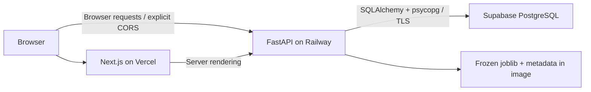

# Deploying PlayerWorth V1

**Status (12 October 2026): application and deployment configuration complete;
not live deployed.** This workstation has no configured Supabase/Railway/Vercel
connector, CLI login or provider token. Provider resources, live URLs and hosted
smoke results are therefore unavailable. Docker is also not installed here, so
the container build remains an external validation step. Local production Next.js,
FastAPI, PostgreSQL and frozen-model inference have been exercised.

## Architecture



The browser never connects to PostgreSQL. Supabase Auth, Storage, client SDK and
Data API are not needed. Disable the Data API for this project, or remove this
schema from exposed schemas, before importing data. This app has no authenticated
write UI; simulator and rankings requests do not persist predictions.

## Environment variable names

| Location | Name | Purpose |
|---|---|---|
| Railway, migration/seed shell | `DATABASE_URL` | Private SQLAlchemy psycopg PostgreSQL connection URI |
| Railway | `CORS_ORIGINS` | Exact HTTPS Vercel origin; comma-separated explicit origins if needed |
| Railway | `MODEL_POINTER_PATH` | Optional; defaults to the packaged V1 pointer |
| Railway | `PORT` | Assigned by Railway; container binds to this on all interfaces |
| Vercel | `NEXT_PUBLIC_API_BASE_URL` | Public Railway API base including `/api/v1` |
| Local Python | `API_HOST`, `API_PORT` | Local launcher binding; container uses `PORT` instead |
| Local integration tests only | `TEST_DATABASE_URL` | Dedicated disposable test database |
| Browser smoke tests | `PLAYWRIGHT_BASE_URL`, `NEXT_PUBLIC_API_BASE_URL` | Hosted frontend and API bases |
| Optional Firefox QA | `TEST_FIREFOX` | Set to `1` where Firefox launches successfully |

Only the API base is public. Never place database credentials, model files or
provider tokens in `NEXT_PUBLIC_*`, committed env files, build arguments or logs.
The repository env examples contain no production secrets.

## 1. Supabase PostgreSQL

Create/select the intended project after signing in. Obtain its exact connection
string from the dashboard; do not guess the host, region, username or project ref.
For this persistent backend use a direct connection when IPv6 is available, or
the **session pooler on port 5432** for IPv4. Avoid transaction pooling for this
initial SQLAlchemy/Alembic deployment. See the official
[connection guide](https://supabase.com/docs/guides/database/connecting-to-postgres).

Use the `postgresql+psycopg` scheme with properly percent-encoded credentials.
Enable SSL enforcement and use `sslmode=verify-full` with the provider's trusted
CA installed/mounted as required by the selected endpoint. Do not disable hostname
verification to bypass a failed connection. See
[SSL enforcement](https://supabase.com/docs/guides/platform/ssl-enforcement).
The exact hosted TLS connection has not been tested from this workstation.

Set `DATABASE_URL` securely in a migration environment and run from the repository
root, using the existing frozen data/model files:

```powershell
python -m alembic upgrade head
python -m scripts.seed_database
python -m scripts.seed_database
```

Expected counts after both seeds: 1,139 players, 27 clubs, 2,594 player-seasons,
2,594 market values, one model run and zero predictions in a fresh database.
The second import is idempotent. Migration `0001` is unchanged. Do not use the
production database as `TEST_DATABASE_URL`. Back up before migrations; do not reset
a hosted database to fix an import error.

## 2. Package the backend

Raw exports and generated artifacts are intentionally Git-ignored. A Git-only
deployment would omit the model. Stage a verified bundle from this trusted workspace:

```powershell
python -m scripts.prepare_release --output .local/release
```

Choose a new output directory for subsequent releases; existing directories are
never overwritten. The script verifies the serialized model with the existing
loader, verifies the processed CSV against model metadata, and hashes each copied
file in `release_manifest.json`. It copies backend/ML Python dependencies, migration,
seed command, configuration, the processed CSV and exactly these model files:

- `ml/models/current_model.json`
- `ml/models/playerworth_v1.joblib`
- `ml/models/playerworth_v1_metadata.json`

No raw CSVs, other experiment artifacts, `.env`, `.local` contents or frontend
dependencies are staged. The processed CSV is included only for controlled seeding;
the API has no route that serves it. No training, downloading or model regeneration
occurs at image build or startup. Preserve the bundle privately; source redistribution
rights remain a documented dataset limitation.

When Docker is available, from the repository root:

```powershell
docker build -t playerworth-v1 .local/release
docker run --rm --env-file .local/production.env -p 8000:8000 playerworth-v1
```

Supply any provider CA file through a read-only mount and reference its container
path in the connection configuration. The image uses Python 3.14, the existing
pinned runtime versions, libgomp for XGBoost, a non-root user and one Uvicorn process.
Start with sufficient memory for Pandas/XGBoost (1 GiB is a starting allocation,
not a measured production requirement); monitor actual use before scaling.

## 3. Railway

After authenticating the Railway CLI and selecting the intended project/service:

```powershell
Set-Location .local/release
railway link
railway up
```

Set the environment variables in the provider dashboard before promotion. The
checked-in `railway.json` selects the Dockerfile and health check
`/api/v1/health`; migrations/seeding are deliberate one-time commands, not startup
side effects. The Docker launcher uses Railway's `PORT`. Generate a provider HTTPS
domain. See [Dockerfiles](https://docs.railway.com/builds/dockerfiles) and
[health checks](https://docs.railway.com/deployments/healthchecks).

The database must already be migrated and seeded for the dependency health check
to pass. Review logs without sharing connection strings. Confirm model version
and health JSON; a running container alone is insufficient.

## 4. Vercel

Sign in and import the frontend project (root directory **frontend**, framework
Next.js, Node 24). `frontend/vercel.json` uses `npm ci` and `npm run build`.
Set `NEXT_PUBLIC_API_BASE_URL` for the selected deployment environment before
building; this value is embedded in client bundles. Changing it requires a redeploy.
See [Vercel environment variables](https://vercel.com/docs/environment-variables).

For a CLI deployment from `frontend`, after authentication:

```powershell
vercel link
vercel --prod
```

Add the exact generated Vercel production origin to Railway's `CORS_ORIGINS`, then
redeploy Railway. Do not use wildcard preview origins. Only explicitly trusted
preview URLs should be added if browser testing needs them. Use provider domains;
no custom domain purchase is needed. A future domain requires DNS, TLS and an
updated exact CORS origin, followed by the same smoke checks.

## 5. Hosted validation

With `NEXT_PUBLIC_API_BASE_URL` and `PLAYWRIGHT_BASE_URL` set to the actual HTTPS
URLs in a local shell, run from `frontend`:

```powershell
npx playwright test
```

The tests discover Haaland through search, exercise season changes, prediction,
simulator/reset, Model Lab, rankings direction/season changes and recovery routes.
The broad viewport/accessibility fixture uses this seeded database's stable ID 582;
the primary user flow discovers its link from the API. Verify the browser's requests
go to Railway, not localhost. Check `/api/v1/health`, `/api/v1/models/current`,
search and the profile response directly. Test CORS preflight with the actual
frontend `Origin`: allow exactly that origin, and reject an unrelated origin.
Record model identity, table counts and prediction count before/after UI smoke tests.
Do not claim success until this entire deployed chain passes.

## Rollback and operational limits

Retain the prior image/release manifest, Vercel deployment and database backup.
Rollback the application image and frontend deployment together if configuration
changes break compatibility. Do not rerun training or regenerate frozen files.
No new schema change was introduced in this milestone; future schema rollback
requires its own plan. Provider backups, retention, alerting and budgets must be
configured in the chosen accounts. No production load test, hosted TLS/CORS check
or container execution has been completed here. Firefox cannot launch on this
workstation. Source license verification and model limitations remain documented
in the frozen model card; estimates are educational analytical outputs.

